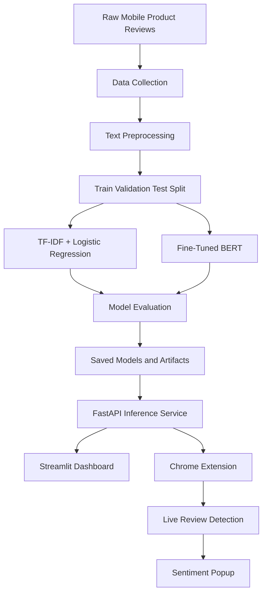

# 📱 Mobile Review Sentiment Analysis & Live Chrome Extension


An end-to-end **Natural Language Processing (NLP) and Machine Learning system** designed to analyze customer sentiment from mobile product reviews.

The project combines a fine-tuned BERT model, a traditional TF-IDF and Logistic Regression baseline, a FastAPI inference service, an interactive Streamlit dashboard, and a Chrome Extension that provides real-time sentiment analysis while browsing supported e-commerce websites.

---

## 📌 Table of Contents

- [Overview](#-overview)
- [Key Features](#-key-features)
- [System Architecture](#-system-architecture)
- [Technologies Used](#-technologies-used)
- [Dataset](#-dataset)
- [Data Preprocessing](#-data-preprocessing)
- [Model Development](#-model-development)
- [Model Evaluation](#-model-evaluation)
- [Backend API](#-backend-api)
- [Streamlit Dashboard](#-streamlit-dashboard)
- [Chrome Extension](#-chrome-extension)
- [Installation](#-installation)
- [Running the Application](#-running-the-application)
- [Docker Deployment](#-docker-deployment)
- [Testing](#-testing)
- [Future Improvements](#-future-improvements)
- [License](#-license)

---

## 🚀 Overview

Online customer reviews contain valuable information about product quality, customer satisfaction, and purchasing decisions. However, manually reading large numbers of reviews is time-consuming and makes it difficult to identify common customer opinions.

This project addresses that problem through an automated sentiment analysis system.

It uses Natural Language Processing and machine learning techniques to classify review text into three sentiment categories:

- 😊 **Positive**
- 😐 **Neutral**
- 😠 **Negative**

The system provides two complementary prediction approaches:

1. **BERT-based sentiment classification:** A fine-tuned transformer model designed to understand contextual meaning in review text.
2. **Traditional machine learning classification:** A TF-IDF feature extraction pipeline combined with Logistic Regression for efficient sentiment prediction.

The trained models are integrated into a FastAPI backend and connected to a Streamlit dashboard and a Chrome Extension.

The result is a complete workflow covering data collection, preprocessing, model training, evaluation, API development, and user-facing deployment.

---

## ✨ Key Features

### 1. Automated Review Collection

- Collects mobile product review data.
- Stores review text and relevant metadata.
- Supports preprocessing before model training.
- Organizes raw and processed datasets separately.

### 2. Text Preprocessing

- Unicode normalization using NFC.
- HTML entity and tag handling.
- Whitespace normalization.
- Removal of unnecessary noise.
- Preservation of important punctuation and sentiment information.
- Consistent preprocessing between training and inference.

### 3. Dual-Model Sentiment Analysis

**BERT model**
- Uses a fine-tuned BERT transformer.
- Captures contextual meaning in review text.
- Predicts sentiment probabilities.
- Supports detailed evaluation using classification metrics.

**TF-IDF and Logistic Regression**
- Converts review text into numerical features.
- Uses a Logistic Regression classifier.
- Provides a lightweight alternative for low-latency inference.
- Serves as a traditional machine learning baseline.

### 4. FastAPI Backend

- Provides REST API endpoints for predictions.
- Supports asynchronous request handling.
- Validates request data.
- Returns structured JSON responses.
- Provides API documentation through Swagger UI.

### 5. Interactive Streamlit Dashboard

- Provides a user-friendly interface.
- Accepts review text for sentiment prediction.
- Displays predicted sentiment and confidence.
- Supports model comparison and evaluation visualizations.

### 6. Live Chrome Extension

- Uses Chrome Extension Manifest V3.
- Detects review text on supported shopping websites.
- Sends review text to the FastAPI backend.
- Displays sentiment predictions in a floating popup.
- Shows confidence scores and detected product aspects.

### 7. Evaluation and Testing

- Evaluates model performance using classification metrics.
- Generates confusion matrices and loss curves.
- Includes preprocessing tests.
- Supports API and prediction testing.

### 8. Docker Support

- Provides containerization configuration.
- Simplifies application deployment.
- Supports running the backend and dashboard as services.

---

## 🏗️ System Architecture

The system follows a modular architecture consisting of data processing, model development, backend services, and user interfaces.



### Architecture Components

| Component | Responsibility |
|---|---|
| Data Collection | Collects and stores raw customer reviews |
| Preprocessing | Cleans and normalizes review text |
| TF-IDF Model | Provides a traditional machine learning baseline |
| BERT Model | Performs contextual sentiment classification |
| FastAPI | Serves prediction requests |
| Streamlit | Provides an interactive analysis dashboard |
| Chrome Extension | Displays predictions while browsing |
| Evaluation Scripts | Measures model performance |
| Docker | Supports containerized deployment |

---

## 🛠️ Technologies Used

| Technology | Purpose |
|---|---|
| Python | Main programming language |
| Pandas | Data manipulation and analysis |
| NumPy | Numerical operations |
| Scikit-learn | Traditional machine learning and evaluation |
| NLTK | Text processing utilities, where required |
| PyTorch | Deep learning framework |
| Hugging Face Transformers | BERT model and tokenizer |
| Hugging Face Datasets | Dataset preparation, where required |
| FastAPI | REST API development |
| Uvicorn | ASGI application server |
| Streamlit | Interactive dashboard |
| Plotly / Matplotlib | Data visualization |
| Joblib | Saving and loading traditional ML artifacts |
| Pytest | Automated testing |
| Docker | Containerization |
| HTML, CSS, JavaScript | Chrome Extension interface and behavior |
| Chrome Extension Manifest V3 | Browser integration |


---

## 📊 Dataset

The project uses mobile product reviews for sentiment classification.

### Dataset Information

| Attribute | Description |
|---|---|
| Data type | Customer review text |
| Main input | Review text |
| Target | Sentiment label |
| Sentiment classes | Positive, Neutral, Negative |
| Data source | Review dataset collected or downloaded for the project |

The dataset may contain review text, product information, ratings, timestamps, and other metadata, depending on the source.

### Dataset Preparation

The data preparation workflow includes:

1. Loading the raw dataset.
2. Checking missing values.
3. Removing duplicate reviews where appropriate.
4. Normalizing review text.
5. Mapping available labels into consistent sentiment classes.
6. Checking class distribution.
7. Splitting the dataset into training, validation, and testing sets.
8. Saving the processed datasets.

Example split:

| Dataset | Proportion |
|---|---:|
| Training | 80% |
| Validation | 10% |
| Testing | 10% |

Use a stratified split when possible to maintain similar class distributions across the subsets.

**Data integrity:** Only report the final number of reviews after verifying the actual dataset. The training, validation, and test sets should not overlap.

---

## 🧹 Data Preprocessing

Text preprocessing improves consistency and reduces unnecessary noise in customer reviews.

### Main Steps

**1. Missing-value handling**

Identify missing review text and remove or handle invalid records.

**2. Duplicate removal**

Remove duplicate records when appropriate, while avoiding accidental removal of genuinely different reviews.

**3. Unicode normalization**

Normalize text using Unicode NFC to ensure consistent character representation.

**4. HTML cleaning**

Handle HTML entities and tags that may appear in collected reviews.

**5. Whitespace normalization**

Remove unnecessary spaces, tabs, and line breaks.

**6. Sentiment preservation**

Avoid removing meaningful words, negations, and punctuation that may affect sentiment.

For example:

```text
Original:
"The phone is NOT good!!!"

Cleaned:
"The phone is NOT good!!!"
```

The word `NOT` is important because it changes the meaning of the review.

### Consistent Preprocessing

The same applicable text-processing rules must be used during training and inference.

For BERT, use the tokenizer associated with the fine-tuned model.

For the traditional machine learning model, use the saved TF-IDF vectorizer and apply the same feature extraction pipeline used during training.

---

## 🤖 Model Development

The project compares a traditional machine learning approach with a transformer-based deep learning model.

### 1. TF-IDF + Logistic Regression

This model serves as the traditional machine learning baseline.

#### Workflow

```text
Review Text
    ↓
Text Preprocessing
    ↓
TF-IDF Vectorization
    ↓
Logistic Regression
    ↓
Sentiment Prediction
```

**TF-IDF** converts text into numerical features based on term frequency and inverse document frequency.

**Logistic Regression** uses these features to predict the sentiment class.

#### Advantages

- Fast inference.
- Lower computational requirements.
- Simple to train and evaluate.
- Useful as a baseline for comparison.

#### Limitations

- Limited understanding of word context.
- May struggle with complex sentence meaning.
- Can have difficulty interpreting sarcasm and subtle sentiment.

### 2. Fine-Tuned BERT

The deep learning model uses `bert-base-uncased` as the pretrained transformer architecture.

BERT generates contextual representations of text, helping the classifier understand how a word's meaning changes according to its surrounding words.

#### Workflow

```text
Review Text
    ↓
BERT Tokenizer
    ↓
Input IDs and Attention Masks
    ↓
Fine-Tuned BERT
    ↓
Classification Probabilities
    ↓
Positive / Neutral / Negative
```

#### Training Process

1. Load the pretrained BERT model.
2. Prepare the labeled dataset.
3. Tokenize review text.
4. Fine-tune the classification model.
5. Monitor validation performance.
6. Evaluate the final model on held-out test data.
7. Save the trained model and tokenizer.

#### Advantages

- Context-aware text representation.
- Better ability to capture relationships between words.
- Suitable for complex natural language patterns.

#### Limitations

- Higher computational requirements.
- Longer training time.
- Larger model size.
- Inference speed depends on the hardware and deployment environment.

---

## 📈 Model Evaluation

The models should be evaluated using the same held-out test dataset and consistent label definitions.

### Evaluation Metrics

| Metric | Meaning |
|---|---|
| Accuracy | Percentage of predictions that are correct |
| Precision | How many predictions for a class are correct |
| Recall | How many actual examples of a class are identified |
| Macro F1-score | Average F1-score across all classes, giving each class equal weight |
| Confusion Matrix | Shows correct and incorrect predictions by class |
| Inference Latency | Time taken to generate a prediction |

Macro-averaged metrics are particularly useful when sentiment classes are imbalanced.

### Reported Results

The following BERT results were included in the project notes. Reproduce the evaluation to confirm them before treating them as final results.

| Metric | Fine-Tuned BERT |
|---|---:|
| Accuracy | 82.95% |
| Macro Precision | 0.8694 |
| Macro Recall | 0.6377 |
| Macro F1-score | 0.7698 |

The traditional TF-IDF + Logistic Regression model should also be evaluated and reported using its actual test results.

Do not compare models using different test splits or incompatible metric definitions.

### Evaluation Visualizations

The project can generate:

- Confusion matrices.
- Training and validation loss curves.
- Model comparison charts.
- Sentiment class distribution plots.
- Classification reports.

Store generated figures in the project's output directory.

---

## ⚡ Backend API

The FastAPI service provides an interface for applications that need sentiment predictions.

### Start the API

From the project root, activate your virtual environment and run the API using your actual module path.

For example, if your FastAPI instance is named `app` inside `api/api.py`:

```powershell
python -m uvicorn api.api:app --host 127.0.0.1 --port 8000 --reload
```

If your application uses a different file or variable name, adjust the command accordingly.

### API Documentation

Once the server is running, open:

- **Swagger UI:** `http://127.0.0.1:8000/docs`
- **Alternative API documentation:** `http://127.0.0.1:8000/redoc`

### Health Check

Example endpoint:

```http
GET /health
```

Example response:

```json
{
  "message": "Review Sentiment API is running"
}
```

The exact response depends on your implementation.

### Sentiment Prediction

Example endpoint:

```http
POST /predict
```

Example request:

```json
{
  "text": "The camera quality is excellent, but the battery drains quickly."
}
```

Example response:

```json
{
  "sentiment": "positive",
  "confidence": 0.85,
  "cleaned_text": "The camera quality is excellent, but the battery drains quickly."
}
```

**Note:** The endpoint, response fields, sentiment label, and confidence values above are illustrative. Your API should return the actual result produced by your model.

### API Responsibilities

- Validate incoming requests.
- Handle invalid or empty review text.
- Load the correct model and tokenizer.
- Return predictions in JSON format.
- Handle inference errors.
- Support requests from the Chrome Extension.

---

## 📊 Streamlit Dashboard

The Streamlit dashboard provides a user-friendly interface for exploring sentiment predictions.

### Start the Dashboard

From the project root, run:

```powershell
python -m streamlit run app/streamlit_app.py
```

Open:

`http://localhost:8501`

### Dashboard Features

Depending on the implemented interface, users can:

- Enter individual product reviews.
- Generate sentiment predictions.
- View confidence scores.
- Compare sentiment classifications.
- Explore model evaluation results.
- Review sentiment distributions and charts.

The dashboard can use the FastAPI backend for predictions or load model artifacts directly, depending on its implementation.

---

## 🌐 Chrome Extension

The Chrome Extension brings sentiment analysis into the user's browsing experience.

It uses **Manifest V3** and communicates with the FastAPI backend.

### Main Features

- Detects review text on supported product pages.
- Sends selected review text to the backend.
- Displays sentiment results in a floating popup.
- Shows confidence scores.
- Identifies potential product aspects such as battery, camera, display, performance, and price, if aspect detection is implemented.

### Install the Extension

1. Start the FastAPI backend.
2. Open Google Chrome.
3. Navigate to `chrome://extensions/`.
4. Enable **Developer mode**.
5. Click **Load unpacked**.
6. Select the extension directory containing `manifest.json`.
7. Open a supported product review page.
8. Test the sentiment analysis feature.

### Extension Workflow

```text
Customer Review on Webpage
          ↓
Chrome Content Script
          ↓
Background Service Worker
          ↓
FastAPI Prediction Endpoint
          ↓
Sentiment Prediction
          ↓
Floating Popup
```

The exact workflow depends on the implementation of your content script and service worker.

### Important Configuration

Ensure the extension's API URL matches the address and port used by FastAPI.

For local development, the backend may run at:

```text
http://127.0.0.1:8000
```

Configure the necessary permissions and Content Security Policy settings in `manifest.json`.

Only request browser permissions required by the extension, and handle webpage text and user data responsibly.

---

## ⚙️ Installation

### Prerequisites

Install the following software before running the project:

- Python 3.11 or another version supported by your pinned dependencies.
- Git.
- Google Chrome.
- Optional: Docker Desktop.
- Optional: NVIDIA GPU and a compatible CUDA-enabled PyTorch build for GPU inference or training.

### 1. Clone the Repository

```powershell
git clone https://github.com/HimashMadushanka/Mobile-Review-Sentiment-Analysis
cd mobile-review-sentiment-analysis
```

Replace the repository URL if your actual GitHub repository uses a different address.

### 2. Create a Virtual Environment

```powershell
python -m venv .venv
```

### 3. Activate the Virtual Environment

For Windows PowerShell:

```powershell
.\.venv\Scripts\Activate.ps1
```

If PowerShell blocks activation, run the following command for the current terminal session:

```powershell
Set-ExecutionPolicy -Scope Process -ExecutionPolicy RemoteSigned
```

Then activate the environment again:

```powershell
.\.venv\Scripts\Activate.ps1
```

### 4. Upgrade pip

```powershell
python -m pip install --upgrade pip
```

### 5. Install Dependencies

```powershell
python -m pip install -r requirements.txt
```

If installation fails with a dependency-resolution error, inspect the complete error message before changing package versions.

Useful diagnostic commands:

```powershell
python --version
python -m pip show torch transformers fsspec datasets
python -m pip check
```

Avoid arbitrarily upgrading or downgrading `fsspec`, PyTorch, Transformers, or Datasets. Choose compatible versions based on the actual dependency constraints in your `requirements.txt`.

### 6. Verify the Installation

```powershell
python -c "import torch; print('PyTorch:', torch.__version__); print('CUDA available:', torch.cuda.is_available())"
```

If CUDA is available, verify that PyTorch can detect your GPU:

```powershell
python -c "import torch; print(torch.cuda.get_device_name(0if torch.cuda.is_available() else 'GPU not available to PyTorch')"
```

The model can also run on a CPU, although training and inference may be slower.

---

## ▶️ Running the Application

Run the services in separate terminal windows, using the same activated virtual environment.

### Terminal 1: Start FastAPI

```powershell
python -m uvicorn api.api:app --host 127.0.0.1 --port 8000 --reload
```

### Terminal 2: Start Streamlit

```powershell
python -m streamlit run app/streamlit_app.py
```

### Terminal 3: Install and Test the Chrome Extension

1. Open `chrome://extensions/`.
2. Enable Developer mode.
3. Load the unpacked extension directory.
4. Visit a supported product review page.
5. Select or inspect a review to test the prediction feature.

### Service URLs

| Service | Local URL |
|---|---|
| Streamlit Dashboard | `http://localhost:8501` |
| FastAPI Backend | `http://127.0.0.1:8000` |
| Swagger UI | `http://127.0.0.1:8000/docs` |
| ReDoc | `http://127.0.0.1:8000/redoc` |

These commands assume the example paths and application names shown above. Update them to match your repository.

---

## 🐳 Docker Deployment

Docker can package the application and its dependencies into a reproducible environment.

### Build the Docker Image

```powershell
docker build -t mobile-review-sentiment-analysis .
```

### Run the Container

```powershell
docker run --rm -p 8000:8000 -p 8501:8501 mobile-review-sentiment-analysis
```

This command exposes both ports, but the container must actually start both services and listen on an appropriate network interface for both to be accessible.

For a more maintainable deployment, use Docker Compose to run FastAPI and Streamlit as separate services.

**Important:** The commands above require a Dockerfile that supports your application architecture. A Dockerfile that starts only FastAPI will not automatically start Streamlit.

---

## 🧪 Testing

Automated tests help verify preprocessing and API behavior.

### Run the Test Suite

```powershell
python -m pytest
```

### Test Preprocessing

```powershell
python -m pytest tests/test_preprocessing.py -v
```

### Test the API

```powershell
python -m pytest tests/test_api.py -v
```

These commands assume the test files exist at the specified locations.

### Recommended Test Cases

- Empty review text.
- Missing input fields.
- Unicode characters and emojis.
- HTML entities and tags.
- Very long reviews.
- Mixed positive and negative opinions.
- Valid sentiment predictions.
- Invalid API requests.
- Model loading failures.
- API requests from the Chrome Extension.

---

## 🔒 Security and Reliability

For reliable deployment, consider the following practices:

- Validate all incoming text.
- Set appropriate request-size limits.
- Configure CORS for trusted origins rather than allowing every origin unnecessarily.
- Keep dependencies updated and compatible.
- Avoid committing API keys or secrets.
- Do not commit virtual environments or unnecessary model caches.
- Handle model-loading and prediction errors gracefully.
- Avoid logging sensitive customer data.
- Use HTTPS and appropriate authentication for production deployments.
- Configure browser extension permissions carefully.

---

## 🚧 Future Improvements

Potential future enhancements include:

- Aspect-based sentiment analysis for product features.
- Multilingual sentiment classification.
- Improved handling of sarcasm and mixed sentiment.
- Larger and more diverse evaluation datasets.
- Model quantization to reduce inference costs.
- GPU-accelerated inference where beneficial.
- Prediction history and analytics.
- Batch review analysis.
- Model monitoring and drift detection.
- Automated model retraining.
- Deployment to a cloud hosting platform.
- More robust support for different e-commerce websites.

---

## 📄 License

This project is intended to be released under the **MIT License**.

Before publishing, add a `LICENSE` file containing the complete MIT License text and confirm that the license is appropriate for the project and its dependencies.

---

## 👨‍💻 Author

**Mobile Review Sentiment Analysis & Live Chrome Extension**

An end-to-end NLP project combining machine learning, deep learning, API development, interactive analytics, and browser-based sentiment analysis.

Built with Python, PyTorch, Hugging Face Transformers, FastAPI, Streamlit, and JavaScript.

---

⭐ **If you find this project useful, consider giving the repository a star on GitHub.*