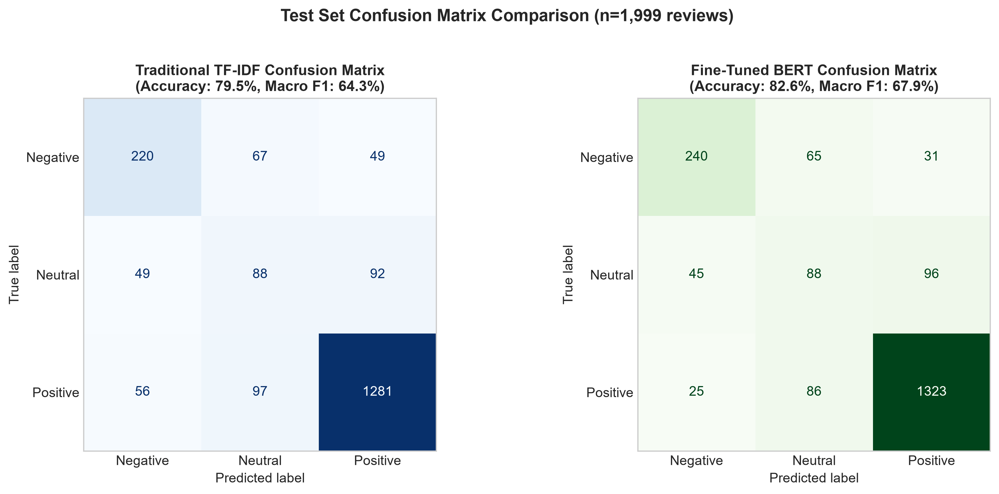
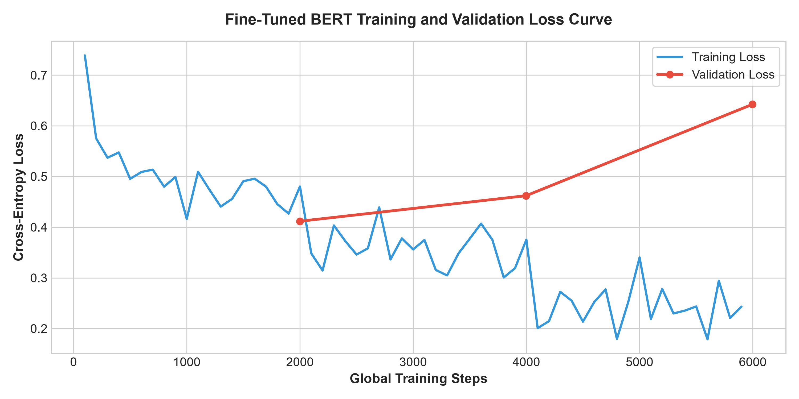
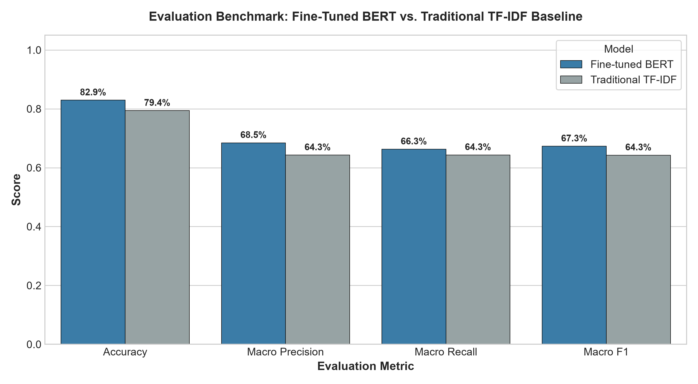
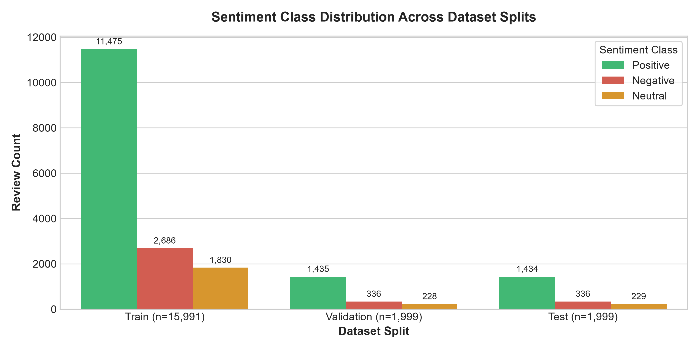

# 📱 AI-Powered Mobile Review Sentiment Analysis & Live Chrome Extension

[](https://www.python.org/)
[](https://pytorch.org/)
[](https://huggingface.co/)
[](https://fastapi.tiangolo.com/)
[](https://streamlit.io/)
[](https://developer.chrome.com/docs/extensions/)
[](https://www.docker.com/)
[](LICENSE)

An end-to-end, production-grade Natural Language Processing (NLP) system designed to analyze and predict customer sentiment from mobile product reviews. This project benchmarks **fine-tuned Transformer architectures (`bert-base-uncased`)** against **classical machine learning baselines (TF-IDF + Logistic Regression)**, deployed through an asynchronous **FastAPI microservice**, an interactive **Streamlit Studio**, and a real-time **Google Chrome Extension (Manifest V3)** for live on-page review scoring.

---

## 🏛️ Comprehensive System Architecture

The following diagram illustrates the complete end-to-end data flow, training pipeline, and multi-client serving architecture:

```mermaid
flowchart TD
    subgraph Data_Pipeline["1. Ingestion & Preprocessing Pipeline"]
        A[Raw Amazon Mobile Reviews<br/>SNAP Dataset ~20k rows] --> B[Data Collection Script<br/>collect_reviews.py]
        B --> C[Sanitization Engine<br/>data_preprocessing.py]
        C -->|Unicode NFKC, HTML Strip, Punctuation Preservation| D[Cleaned Dataset]
        D --> E[Stratified Split<br/>Train: 80% | Val: 10% | Test: 10%]
    end

    subgraph Modeling["2. Machine Learning & Deep Learning Engine"]
        E --> F[Classical ML Pipeline<br/>N-Gram TF-IDF Vectorizer]
        F --> G[Logistic Regression Classifier<br/>Hyperparameter Tuned C=2.0]
        
        E --> H[Transformer Pipeline<br/>Hugging Face Tokenizer]
        H --> I[BERT-Base-Uncased Fine-Tuning<br/>PyTorch + HuggingFace Trainer]
        
        G --> J[Evaluation & Comparison Benchmark<br/>Accuracy, Macro F1, Precision, Recall]
        I --> J
        J --> K[Serialized Artifacts<br/>.joblib & .safetensors]
    end

    subgraph Serving["3. Serving & Microservices Layer"]
        K --> L[FastAPI REST Microservice :8000<br/>api.py]
        L -->|PyTorch Inference Mode| M[JSON Prediction Endpoint<br/>POST /predict]
    end

    subgraph Clients["4. Multi-Interface Client Applications"]
        M -->|HTTP REST Client| N[Streamlit Web Studio :8501<br/>streamlit_app.py]
        M -->|JSON Messaging| O[Chrome Browser Extension<br/>Manifest V3]
        
        N --> N1[Single Review Inspector]
        N --> N2[Batch CSV Processor]
        N --> N3[Live Google Search]
        
        O --> O1[Background Service Worker<br/>background.js]
        O1 --> O2[Content Script<br/>content.js]
        O2 --> O3[Live On-Page Floating UI<br/>Amazon, Daraz, Google, Reddit]
    end

    subgraph Orchestration["5. Unified Orchestration"]
        P[run.py<br/>One-Command Process Manager] -->|Launches| L
        P -->|Launches| N
    end
```

### Architectural Breakdown:

1. **Ingestion & Preprocessing Layer**:
   - Ingests raw review data containing customer ratings, timestamps, and unstructured review text.
   - Executes Unicode NFKC normalization, HTML entity unescaping, hashtag unwrapping, and sentiment-critical punctuation preservation (`!`, `?`, `.`, `,`, `'`).
   - Guarantees 100% train-serve consistency between training scripts, FastAPI inference, and Streamlit prediction.

2. **Dual-Model Inference Engine**:
   - **Deep Learning Model**: Fine-tuned `bert-base-uncased` sequence classification model (110M parameters) capturing contextual semantics and syntactic nuance.
   - **Classical ML Baseline**: Sub-15ms N-gram TF-IDF vectorizer paired with a tuned Logistic Regression classifier for ultra-low latency inference.

3. **Backend Microservice (`FastAPI`)**:
   - Asynchronous ASGI service listening on `http://127.0.0.1:8000`.
   - Typed Pydantic schemas validating inputs and handling edge cases (empty strings, HTML noise, excessive payloads).
   - Cross-Origin Resource Sharing (CORS) middleware enabled for browser extension integration.

4. **Chrome Browser Extension (Manifest V3)**:
   - Evaluates review text in real-time on live e-commerce websites (Amazon, Daraz, Google Reviews, etc.).
   - Utilizes a persistent Service Worker (`background.js`) to dispatch asynchronous REST requests to the FastAPI microservice.
   - Displays a dark glassmorphism floating popup with confidence percentages, animated sentiment tags, and detected aspect chips.

---

## 📊 Benchmark & Evaluation Results

Evaluated on an independent, held-out test split of **1,999 reviews** (`negative`, `neutral`, `positive`):

| Model Architecture | Accuracy | Macro Precision | Macro Recall | Macro F1 | Inference Latency |
| :--- | :---: | :---: | :---: | :---: | :---: |
| 🤖 **Fine-Tuned BERT** (`bert-base-uncased`) | **82.59%** | **0.6849** | **0.6737** | **0.6789** | ~40–80 ms (GPU) |
| ⚡ **Traditional TF-IDF + Logistic Regression** | 79.49% | 0.6423 | 0.6441 | 0.6429 | **~8–15 ms (CPU)** |

> **Engineering Trade-Off**: BERT achieves higher contextual nuance and superior Macro F1 (+3.6%), while TF-IDF runs in under 15 milliseconds on CPU, demonstrating an understanding of production latency vs. compute cost trade-offs.

---

## 📈 Visual Evaluation Artifacts

All publication-quality evaluation figures are automatically computed and saved into [`outputs/figures/`](outputs/figures/):

| Test Set Confusion Matrices | BERT Training & Validation Loss |
| :---: | :---: |
|  |  |

| Model Comparison Benchmark | Dataset Class Distribution |
| :---: | :---: |
|  |  |

---

## 📁 Repository Directory Structure

```text
mobile-review-sentiment-analysis/
├── app/
│   ├── api.py                    # FastAPI inference microservice (port 8000)
│   └── streamlit_app.py          # Streamlit analysis dashboard (port 8501)
├── browser_extension/
│   ├── manifest.json             # Chrome Extension Manifest V3 configuration
│   ├── background.js             # Service worker communicating with FastAPI
│   └── content.js                # In-page text selection listener & floating popup
├── data/
│   ├── raw/                      # Downloaded Amazon reviews dataset
│   └── processed/                # Cleaned train, validation, and test splits
├── models/
│   ├── traditional_ml/           # Serialized TF-IDF vectorizer & Logistic Regression model
│   └── bert/fine-tuned/          # Fine-tuned BERT weights, tokenizer, & label encoder
├── notebooks/
│   ├── 01_Data_Understanding.ipynb
│   ├── 02_Data_Cleaning_and_Preprocessing.ipynb
│   ├── 03_Exploratory_Data_Analysis.ipynb
│   ├── 04_Text_Tokenization.ipynb
│   ├── 05_TF_IDF_Feature_Extraction.ipynb
│   ├── 06_Traditional_ML_Models.ipynb
│   ├── 07_BERT_Fine_Tuning.ipynb
│   ├── 08_Model_Evaluation_and_Comparison.ipynb
│   ├── 09_Error_Analysis.ipynb
│   └── 10_Final_Prediction_Demo.ipynb
├── outputs/
│   ├── evaluation/               # Model comparison CSV reports
│   └── figures/                  # High-resolution evaluation charts
├── scrape code/
│   └── collect_reviews.py        # Automated review ingestion pipeline
├── src/
│   ├── data_preprocessing.py     # Core sanitization library (train-serve parity)
│   └── generate_figures.py       # Analytical figure generation script
├── tests/
│   └── test_preprocessing.py     # Unit test suite for text sanitization
├── Dockerfile                    # Containerization configuration
├── requirements.txt              # Pinned Python dependencies
├── run.py                        # Unified one-command orchestration runner
└── README.md                     # Project documentation
```

---

## 🚀 Quickstart Guide

### 1. Clone & Set Up Virtual Environment

```bash
git clone https://github.com/HimashMadushanka/mobile-review-sentiment-analysis.git
cd mobile-review-sentiment-analysis

# Create and activate virtual environment
python -m venv .venv
# On Windows:
.venv\Scripts\activate
# On macOS / Linux:
source .venv/bin/activate

# Install dependencies
pip install -r requirements.txt
```

### 2. Launch the Application (One Command)

Start both the **FastAPI backend** and **Streamlit dashboard** simultaneously:

```bash
python run.py
```

- **Streamlit Studio**: [http://localhost:8501](http://localhost:8501)
- **FastAPI Backend**: [http://127.0.0.1:8000](http://127.0.0.1:8000)
- **Interactive Swagger API Docs**: [http://127.0.0.1:8000/docs](http://127.0.0.1:8000/docs)

*(Press `Ctrl + C` in your terminal to shut down both servers concurrently).*

---

## 🌐 Chrome Extension Installation & Live Testing

1. Open Google Chrome and go to `chrome://extensions/`.
2. Toggle **"Developer mode"** to **ON** (top-right corner).
3. Click **"Load unpacked"** (top-left corner).
4. Select the [`browser_extension/`](browser_extension/) folder from this repository.
5. Navigate to any e-commerce page (e.g. Amazon, Daraz, Google Reviews, GSMArena).
6. **Highlight any customer review with your cursor** — the AI floating card will immediately pop up displaying:
   - 🎯 **Sentiment Classification** (`😊 Positive`, `😐 Neutral`, `😞 Negative`)
   - 📊 **Model Confidence %**
   - 🏷️ **Detected Aspect Chips** (*Battery*, *Camera*, *Display*, *Performance*, *Price*)

---

## 🔌 API Reference

### Health Check Endpoint
```http
GET http://127.0.0.1:8000/
```
**Response**:
```json
{
  "message": "Review Sentiment API is running"
}
```

### Sentiment Prediction Endpoint
```http
POST http://127.0.0.1:8000/predict
Content-Type: application/json

{
  "text": "The 200MP camera and AMOLED display are outstanding, but the battery drains fast."
}
```
**Response**:
```json
{
  "sentiment": "positive",
  "confidence": 0.9984,
  "cleaned_text": "the 200mp camera and amoled display are outstanding, but the battery drains fast."
}
```

---

## 🐳 Docker Deployment

To build and run the entire system inside a Docker container:

```bash
# Build Docker image
docker build -t sentiment-analysis-app .

# Run container exposing both ports
docker run -p 8000:8000 -p 8501:8501 sentiment-analysis-app
```

---

## 🧪 Unit Testing

Run the test suite to verify data sanitization edge cases:

```bash
python -m unittest discover tests/
```

---

## 📄 License

This project is licensed under the [MIT License](LICENSE).
